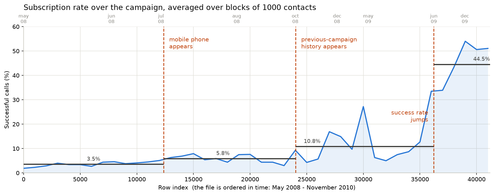

# Bank telemarketing under temporal validation

In this repo we train ML models to predict the outcome of telemarketing calls by a Portuguese
bank, selling subscriptions to long-term deposits. The dataset is `bank-additional-full.csv`
(UCI, 41,188 contacts, May 2008 – November 2010), a popular one in ML tutorials and portfolio
projects.

Almost all of those projects validate on a **random** split. But the file is ordered in time,
and its statistics move underneath the model: the subscription rate goes from 3.5% over the first
months to 44.5% from June 2009 onwards. **This repo asks what is left of the usual results when the
folds are drawn in time order instead.**



## Headline

| logistic regression, client features, `duration` excluded | ROC-AUC |
|---|---|
| random 10-fold (§4.3) | **0.6682** |
| temporal 10-fold (§4.1) | **0.5433** |

Same model, same features, same first 80% of the file: only the way the folds are drawn changes.
The scored rows are not exactly identical (the temporal folds never score the first 3,000, so the
base rate is 0.068 against 0.064), but the random folds report **0.125 ROC-AUC** more.

## The specific question

`bank-additional-names.txt`, shipped with the data, claims that the five macro socio-economic
features (`emp.var.rate`, `cons.price.idx`, `cons.conf.idx`, `euribor3m`, `nr.employed`) "lead
to substantial improvement in the prediction of a success, even when the duration of the call
is not included". Does that hold under temporal validation?

| adding the 5 macro features is worth (ROC-AUC) | random folds | temporal folds |
|---|---|---|
| logistic | +0.0046 | −0.0119 |
| forest | +0.0122 | −0.0185 |
| boosting | +0.0102 | +0.0055 |

With random folds all six comparisons (three models × `duration` in/out) come out positive,
but small: +0.003 to +0.012. With temporal folds four of the six turn negative. On the held-out
test set the difference is +0.0014, smaller than the gap between two model families.

**Why.** A plausible explanation is that the macro features are functions of calendar time, so
they act as a proxy for *when* a call was made, and hence for the local subscription rate. Under
a shuffled split the model is trained on each row's neighbours and can interpolate that rate.
Under a temporal split it has to extrapolate that clock past the end of its training data, where
the fitted coefficients need not apply.

## Results

| protocol | rows | base rate | with macro | client only |
|---|---|---|---|---|
| §4.1 temporal 10-fold, one fit | first 80% | 0.068 | 0.5314 | 0.5433 |
| §4.2 temporal, rolling window | first 80% | 0.070 | 0.5651 | **0.5799** |
| §4.3 random 10-fold | first 80% | 0.064 | 0.6728 | 0.6682 |
| §4.4 rolling window, **test set** | last 20% | 0.308 | 0.7647 | 0.7633 |

*(ROC-AUC, logistic regression, `duration` excluded throughout.)*

**Retraining is the only change that improved a deployable model.** Refitting every 50 contacts
on the previous 5,000 rows gives +0.0366 ROC-AUC over a single fit per fold (§4.1), and moves
AP/baseline from 1.29 to 1.60. The two are scored on nearly the same rows: the rolling window
cannot score the first 5,000 rows of the file, the temporal folds skip the first 3,000.

**On the test set** (8,238 contacts, base rate 30.8%) the delivered logistic regression reaches
ROC-AUC 0.765 and lift 2.33 in the top decile: calling the best-scored 10% of clients finds 2.3
times as many subscribers as calling 10% at random. Including `duration` raises test ROC-AUC
from 0.765 to 0.843 in this experiment. Since the duration of a call is unavailable before the
call, this result is reported only as a retrospective benchmark.

> §4.4 is **not** comparable with the other three protocols: the test set is the late,
> high-success regime, §4.1–4.3 score the early one. And §4.1–4.3 do not score exactly the same
> rows either, so their differences are indicative, not exact. A single number for "the
> performance of the model" does not exist on this dataset.

## Not a replication

> S. Moro, P. Cortez, P. Rita, *A data-driven approach to predict the success of bank
> telemarketing*, Decision Support Systems **62** (2014) 22–31,
> [doi:10.1016/j.dss.2014.03.001](https://doi.org/10.1016/j.dss.2014.03.001)

This file is a public subset: 41,188 of their 52,944 contacts, ending November 2010 instead of
June 2013, and containing only a handful of the 22 features their selection procedure kept.
Everything about the interest rate offered, the agent, the call context and the bank's internal
client profiling is absent.

## Running it

```bash
pip install -r requirements.txt
jupyter notebook Bank_Marketing_Project.ipynb
```

The dataset is included in the repo, so the notebook runs top to bottom as is. §4.2 and §4.3
are the slow cells (a few minutes each).

## Data and licence

The code in this repo is MIT (see `LICENSE`). The dataset is **not** mine: it is the UCI Bank
Marketing dataset, created by S. Moro, P. Cortez and P. Rita, distributed by the
[UCI Machine Learning Repository](https://archive.ics.uci.edu/dataset/222/bank+marketing) under
a **Creative Commons Attribution 4.0 International (CC BY 4.0)** licence, and redistributed
here under those terms. If you use it, cite the paper above, as `bank-additional-names.txt`
asks.
